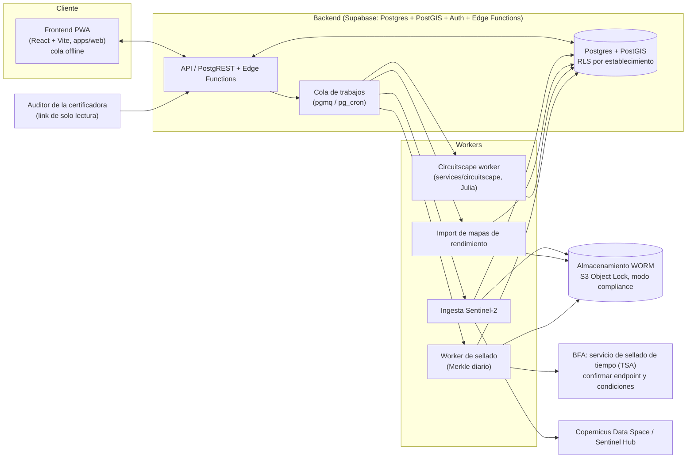
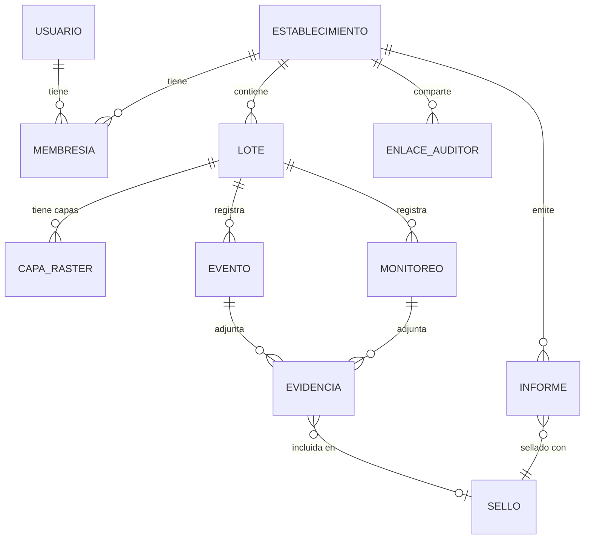
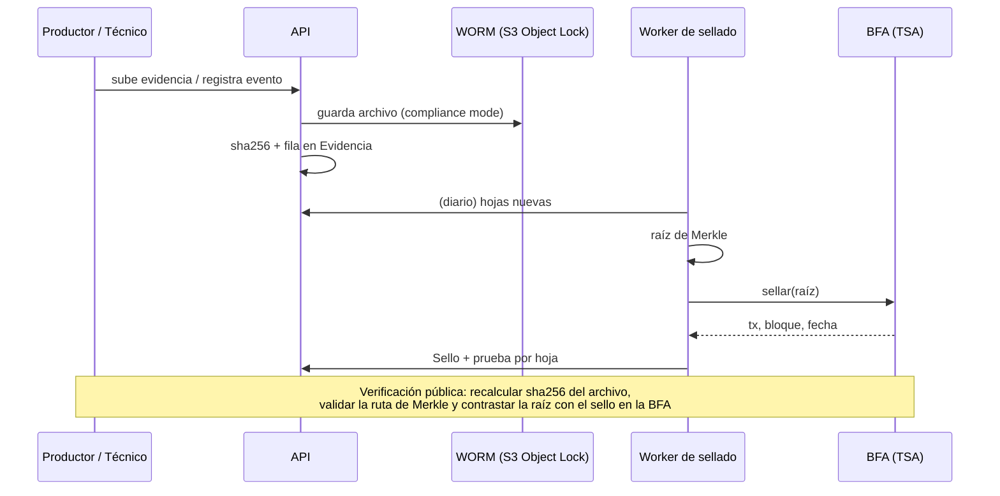

# Arquitectura objetivo — Syntra (producción)

> Estado: **diseño**. Hoy Syntra es un prototipo de frontend con datos mock (`packages/data`). Este documento define a dónde se va y qué decisiones faltan. Lo que depende de cuentas o acuerdos externos está marcado como pendiente.

## 1. Vista general

## 2. Stack recomendado

**Recomendación: Supabase (Postgres + PostGIS + Auth + Edge Functions + Storage) como backend, workers aparte en contenedores.**

Por qué:
- **PostGIS nativo**: polígonos de lotes, intersecciones con parches de bosque, superficies para los reportes. Es el núcleo del dominio.
- **Auth + Row Level Security**: el aislamiento por establecimiento y los roles (incluido el link de solo lectura del auditor) se expresan como políticas SQL, sin escribir un sistema de permisos propio. Un equipo chico ahorra semanas.
- **Edge Functions (Deno/TS)** para la lógica liviana y TypeScript de punta a punta (tipos compartidos con `packages/data`).
- Los trabajos pesados (Julia, ingesta de imágenes) **no** van en Edge Functions: corren como contenedores worker que consumen una cola.

Alternativa válida si se prefiere control total o evitar el proveedor: **Node + Fastify + Postgres/PostGIS** autogestionado (más trabajo de auth y despliegue, mismo modelo de datos). El modelo y los workers de este documento no cambian.

Frontend: la app actual como **PWA** (service worker + cola de monitoreos en IndexedDB que se sincroniza al volver la señal).

## 3. Modelo de datos

| Entidad | Campos principales | Notas |
|---|---|---|
| **Establecimiento** | id, nombre, RENSPA, ecorregión, propietario | Unidad de aislamiento de datos |
| **Lote** | id, establecimiento_id, nombre, cultivo, `geom` (PostGIS `Polygon`, SRID 4326), ha (calculada) | Índice GiST sobre `geom` |
| **Capa / Raster** | id, lote_id (o establecimiento), tipo (NDVI, rendimiento, inundable, resistencia, corriente), fecha, uri (objeto en storage), hash, fuente | Rasters como COG en storage; metadatos en DB |
| **Monitoreo** | id, lote_id, fecha, sitio (punto), polinizadores, enemigos naturales, riqueza, autor | Se crea offline, sincroniza después |
| **Evento** | id, lote_id, tipo (siembra, aplicación, implantación, análisis, cosecha, pérdida/reposición), fecha, payload JSON | Append-only |
| **Evidencia** | id, evento/monitoreo_id, archivo (uri WORM), sha256, bytes, fuente | Inmutable: nunca se actualiza |
| **Sello** | id, raíz de Merkle, lista de hojas, tx, bloque, fecha, red | Producido por el worker de sellado |
| **Informe** | id, certificación objetivo, emitido, manifiesto, sello_id, estado de revisión, dictamen del auditor (archivo) | Syntra no firma: el dictamen lo aporta la certificadora |
| **Usuario** | id, email, rol | Roles abajo |
| **Enlace auditor** | token, informe/establecimiento, vence, revocado | Solo lectura, con vencimiento |

**Roles**: `productor` (escribe en su establecimiento), `técnico` (escribe monitoreos y eventos en los establecimientos que se le asignen), `auditor-certificadora` (solo lectura, solo informes/evidencias compartidos).

## 4. Servicios

| Servicio | Qué hace | Tecnología |
|---|---|---|
| **Ingesta Sentinel-2** | Descarga escenas sobre los lotes, calcula NDVI/cambio de cobertura, guarda COG + hash | Python (rasterio) o evalscripts de Sentinel Hub; fuente Copernicus Data Space |
| **Importador de rendimiento** | Lee shapefile/CSV de monitores de cosechadora, interpola a raster, guarda zonas de rinde | Python/GDAL |
| **Circuitscape worker** | Toma resistencia + parches, corre `compute(ini)` pairwise, guarda mapa de corriente y corredores. Ya hay una implementación base en `services/circuitscape/` (sin probar) | Julia + Circuitscape.jl, contenedor |
| **Worker de sellado** | Una vez por día: junta las huellas nuevas (evidencias, informes), arma el árbol de Merkle, sella la raíz en la BFA, guarda la prueba (ruta de Merkle) por hoja | Contenedor/cron; usa el adaptador `Sellador` (`apps/web/src/lib/sellado.ts` define la interfaz del lado cliente) |
| **Almacenamiento WORM** | Guarda archivos originales sin posibilidad de modificarlos ni borrarlos durante el período de retención | S3 (o compatible) con **Object Lock en modo compliance** |

### Sellado y verificación

La cadena guarda solo la raíz; los datos quedan en Syntra. La blockchain prueba **cuándo** existía el dato y que **no cambió**; que el dato sea real lo verifica el auditor de la certificadora.

Sobre la BFA: el sellado se haría contra el **servicio de sellado de tiempo de la BFA (TSA) — confirmar endpoint y condiciones de uso** (https://bfa.ar). No asumimos detalles de su API; el prototipo usa un sellador simulado con la misma interfaz que usaría el real.

## 5. Seguridad y privacidad

- **El productor es dueño de sus datos.** Se exportan completos en formato abierto (GeoJSON + JSON, ver `apps/web/src/lib/exportar.ts`) y puede pedir su baja. Las huellas selladas no contienen datos legibles.
- **Aislamiento por establecimiento** con RLS; ningún rol ve datos de otro establecimiento.
- **Auditor: enlace de solo lectura**, con vencimiento y revocable, limitado a los informes/evidencias que el productor elige compartir. Sin cuenta ni escritura.
- **Evidencia inmutable**: WORM + sellado; las correcciones se registran como eventos nuevos, nunca editando el original.
- Cifrado en tránsito (TLS) y en reposo; secretos (claves BFA, Sentinel Hub) solo en el backend, nunca en el cliente.
- Ubicación de predios es dato sensible: no se publica en verificación pública más allá de lo que el productor autorice (EUDR exige geolocalización, se comparte solo con el comprador/certificador).
- Cumplimiento de la ley de protección de datos personales (Ley 25.326): revisar con asesoría legal antes de lanzar.

## 6. Qué es real hoy y qué está simulado

| Componente | Hoy | Producción |
|---|---|---|
| Mapa, dibujo de lotes y polígonos | **Real** (Leaflet; polígonos en el navegador) | Persistidos en PostGIS |
| SHA-256 y árbol de Merkle | **Real** (Web Crypto, en el navegador) | Igual, más prueba por hoja en el worker |
| Anclaje en la BFA (tx, bloque) | **Simulado** (derivado de la raíz) | Worker + TSA de la BFA (falta alta) |
| Modelo de conectividad | **Real pero simplificado**: método tipo Circuitscape en el navegador sobre datos mock | `services/circuitscape` (Julia, sin probar) |
| Satélite / NDVI | Mock (hay trabajo en curso para Sentinel-2) | Ingesta real |
| Mapa de rendimiento, inundables | Mock | Importador de monitores / capa hidrológica |
| Informe PDF por certificación | **Real** (generado en el navegador, sellado simulado) | Igual, con sello real y verificación pública |
| Requisitos FSA / GlobalG.A.P. | Representativos, **sin validar** biológicamente | Mapeo oficial validado con el equipo científico |
| Usuarios, persistencia, permisos | No existen (datos en memoria/local) | Backend + Auth + RLS |
| Offline | No (hay trabajo en curso) | PWA con cola |
| Almacenamiento WORM | No existe | S3 Object Lock |

## 7. Decisiones que debe tomar el equipo

1. **Hosting y cuentas**: Supabase (o alternativa), cuenta cloud para workers y S3, dominio.
2. **Alta en la BFA**: proceso de onboarding, endpoint y condiciones de uso del sellado, costos y límites, entorno de pruebas.
3. **Datos satelitales**: Copernicus Data Space (gratis, requiere cuenta) vs. Sentinel Hub (pago por uso) vs. Google Earth Engine (licencia según uso comercial).
4. **Retención WORM**: cuántos años (alinear con los ciclos de auditoría de las certificaciones) y modo compliance (irreversible: ni el administrador puede borrar).
5. **Costos a estimar**: Postgres/Supabase, almacenamiento de rasters y evidencia, cómputo de Julia por corrida, imágenes satelitales, sellado BFA, dominio, soporte. Falta cuantificar; no hay cifras todavía.
6. **Modelo de acceso del técnico**: asignación por productor, o por organización (asesor con varios clientes).
7. **Política de datos**: términos de propiedad, exportación y baja; consentimiento para compartir geolocalización.
8. **Validación de requisitos** FSA/GlobalG.A.P. con el equipo científico antes de mostrarlos como "cumple".
9. **Aceptación del auditor**: confirmar con una certificadora real qué formato de evidencia y verificación considera suficiente.
